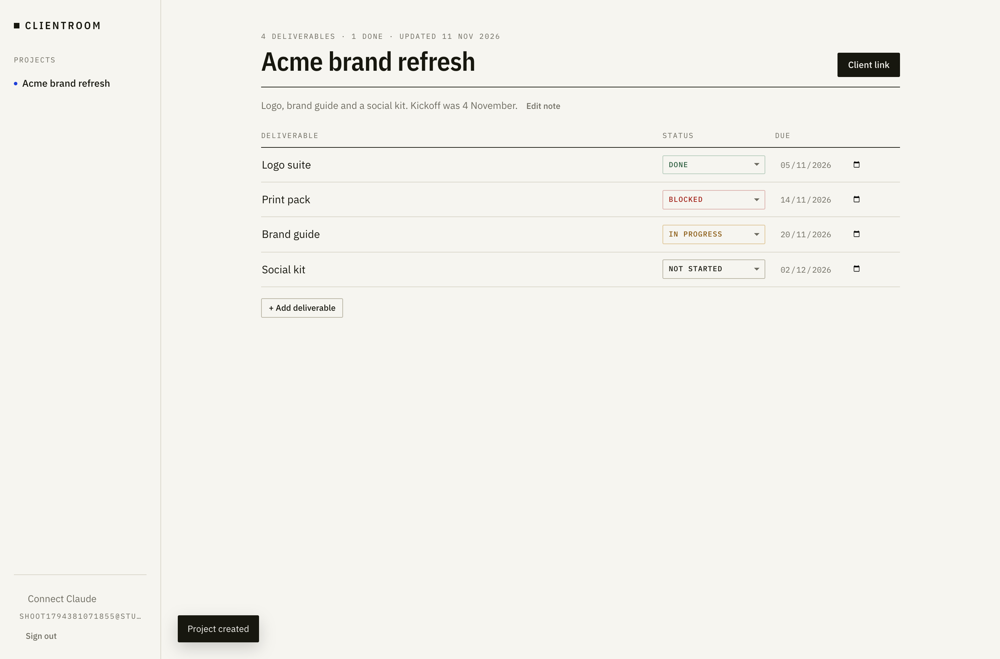
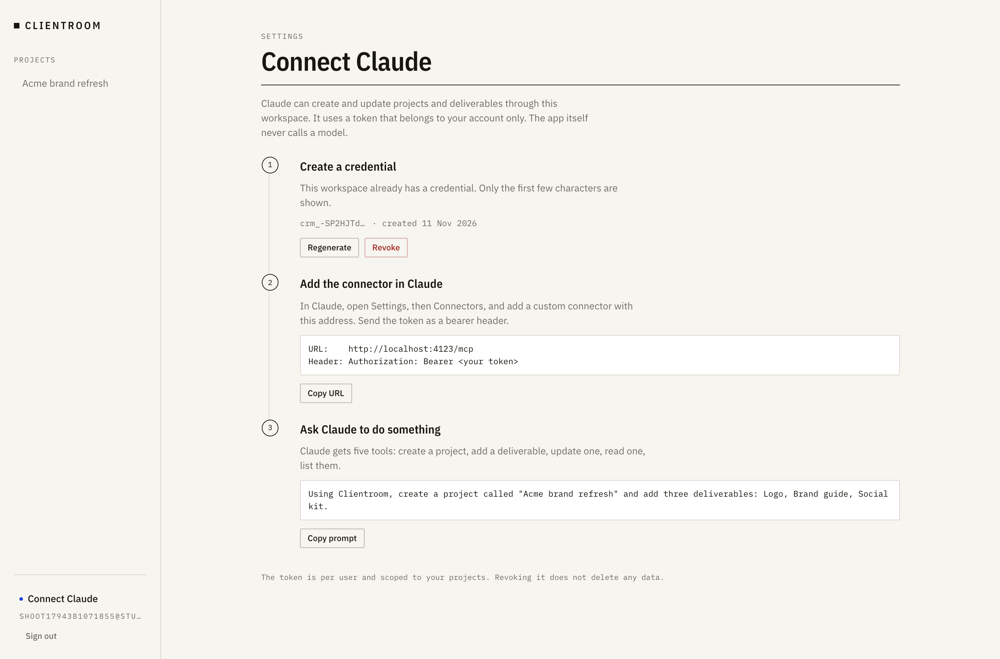
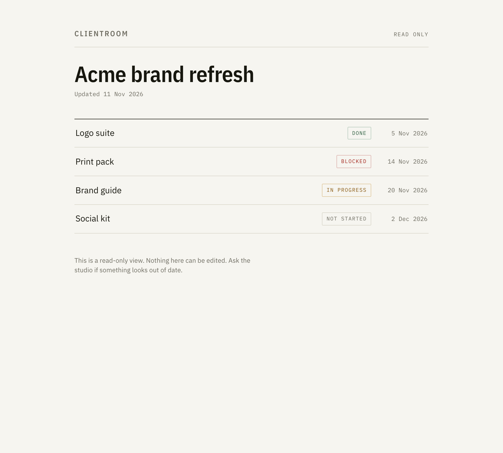
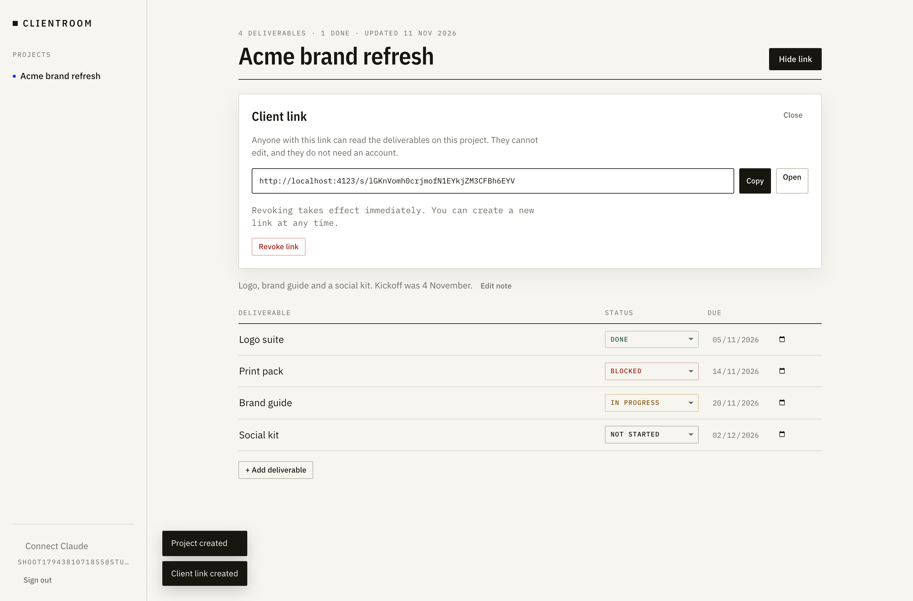
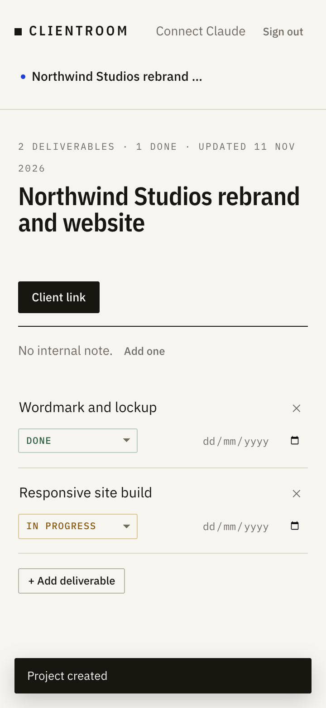

# Clientroom

A delivery workspace for a small design studio: one project per client engagement, the
deliverables inside it, and a read-only link the client can open without an account.

The studio can work entirely in the app. If they also use Claude, they connect it to
Clientroom with a token and ask for the same work in a sentence. The app itself has no
model in it: no SDK, no API key, no outbound inference call. Claude is a second way to
reach the same database, not a feature of the product.

Live app: https://clientroom-production.up.railway.app
MCP endpoint: https://clientroom-production.up.railway.app/mcp
Demo account: `demo@clientroom.app` / `clientroom-demo-2026` (a seeded sample project, labelled Sample, safe to edit)

## Security notes

- The demo account holds only fabricated sample data: one project with four deliverables.
- Ownership is enforced on every read and write; the isolation test proves a second account
  gets a 404 for another account's project. The demo account cannot read anyone else's.
- MCP credentials are per user. The demo account has none until one is created, and any
  credential created there is separate from a personal account's.
- No production secret is committed: `gitleaks` finds nothing in tracked files, only an
  ignored scratch file. Secrets live in Railway variables.
- The demo password is seeded from `SEED_PASSWORD`. To rotate it after evaluation, update
  that variable, delete the demo user row, and redeploy; the seed recreates the account.
  The MCP credential can be regenerated at any time from Settings.

## The product in five steps

1. Sign up with an email and a password.
2. Create a project and name the client engagement.
3. Add deliverables, and set a status and a due date on each one.
4. Open the client link and send it to the client. They read, they cannot edit.
5. Revoke the link when the engagement ends. Access stops on the next page load.

Every screen has an empty, loading, error and success state. The whole workflow is
reachable with the keyboard alone.



## Two ways in

**The app.** Session cookie, one workspace per account, everything scoped to the owner.
Projects on the left, the deliverable table on the right, inline editing in place. Nothing
saves through a modal and nothing needs a page reload.

**Claude.** Settings, then Connect Claude, then create a credential. The token is shown
once; only a prefix is kept afterwards, because the database stores a SHA-256 hash. Paste
the endpoint into Claude as a custom connector with an `Authorization: Bearer` header. The
server exposes exactly five tools:

| Tool | Does |
| --- | --- |
| `create_project` | Makes a project for the calling user |
| `create_item` | Adds a deliverable to a project |
| `update_item` | Changes title, status or due date |
| `get_project` | Returns one project with its deliverables |
| `list_projects` | Returns the caller's projects |

Five tools is the whole surface. There is no delete tool and no share-link tool over MCP,
because deleting and sharing stay deliberate acts in the app.



## The client side

The client opens one link and reads the same table, without signing in and without a
permissions dialog. Revoking the link ends access on the next load.

| Client view | Share panel |
| --- | --- |
|  |  |

On a phone the rail becomes a two row header: brand and account on the first line, the
project list under it.



## Stack and the reasoning

Node 22 with Express 5, React 19 with Vite, handwritten CSS, SQLite through
`better-sqlite3`, and the official MCP SDK.

SQLite is the database on purpose. The workload is one studio, a handful of projects, and
hundreds of rows. A file plus a volume covers it, and a backup is a file copy. The
constraint that follows is stated plainly in [docs/05-operations.md](docs/05-operations.md):
one instance only, because a second replica would write to its own volume.

Sessions are a signed HMAC cookie, not a sessions table. That keeps the schema at four
tables (`users`, `projects`, `items`, `share_links`) and keeps every request stateless.
Logout clears the cookie.

Share links store the token hashed for lookup and an encrypted copy so the owner can copy
the link again without creating a new one. One active link per project.

## Run it locally

```bash
cp .env.example .env      # set SESSION_SECRET, leave DATABASE_PATH as is
npm install
npm run dev               # api on :3000, vite on :5173
```

`APP_ORIGIN` must match the origin you open, because it drives cookie security and the
share-link prefix. For the dev server that is `http://localhost:5173`.

Production build:

```bash
npm run build
npm start                 # serves the API, the built SPA and the share page on PORT
```

## Tests

```bash
npm test                  # 36 backend tests: auth, CRUD, isolation, share, MCP
npm run test:e2e          # 8 Playwright tests: workflow, keyboard, axe, responsive
npm run typecheck
```

The MCP suite speaks JSON-RPC over HTTP to a live server with a real token, so it tests
the transport and the tool schemas rather than calling functions directly. The browser
suite runs against the production build. [docs/07-test-report.md](docs/07-test-report.md)
records what was run and what was not.

## Deploy

Railway, one service, one volume at `/data`, environment variables for secrets
(`DATABASE_PATH`, `SESSION_SECRET`, `APP_ORIGIN`, `NODE_ENV`, and the optional seed
values). The full runbook, including the backup and restore procedure and the
single-instance constraint, is in [docs/05-operations.md](docs/05-operations.md).

Deployed at `https://clientroom-production.up.railway.app` with the service `clientroom`,
the volume `clientroom-volume` mounted at `/data`, and a Let's Encrypt certificate. The
production acceptance run and the redeploy persistence check are recorded in
[docs/07-test-report.md](docs/07-test-report.md).

## What it does not do

No invoices, no chat, no file uploads, no time tracking, no notifications, no client
accounts, no second share link. No AI in the product. The list, with the reason for each
omission, is [docs/08-limitations.md](docs/08-limitations.md).

## Documents

| File | Answers |
| --- | --- |
| [docs/00-product-requirements.md](docs/00-product-requirements.md) | Who it is for, what is in, what is out |
| [docs/01-journeys-and-screens.md](docs/01-journeys-and-screens.md) | Every screen, state and journey |
| [docs/02-acceptance-and-traceability.md](docs/02-acceptance-and-traceability.md) | Binary criteria, evidence, assignment mapping |
| [docs/03-architecture.md](docs/03-architecture.md) | Data model, routes, auth, error model |
| [docs/04-implementation-checklist.md](docs/04-implementation-checklist.md) | Build order and what was ticked |
| [docs/05-operations.md](docs/05-operations.md) | Deploy, secrets, backups, restore, incidents |
| [docs/06-mcp-reference.md](docs/06-mcp-reference.md) | Tool schemas, error codes, connection steps |
| [docs/07-test-report.md](docs/07-test-report.md) | What passed, when, and what it does not prove |
| [docs/08-limitations.md](docs/08-limitations.md) | Deliberate gaps and what a next version would fix |
| [docs/demo-script.md](docs/demo-script.md) | Five minute walkthrough |
