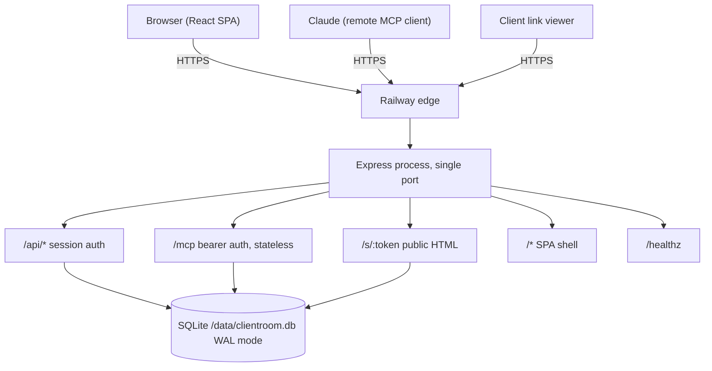

# Clientroom: complete handover

Consolidated handover for the Volopay Founder's Office, Product and Growth assignment.
This document combines the essential content of the fourteen documents in
`docs/final-handover/`. For full detail, follow the links.

## 1. Product

Clientroom is a client delivery workspace for a small design, branding or creative
agency. One project per client engagement, the deliverables inside it, and a read-only
link the client can open without an account.

One sentence: the studio's delivery list, always current, visible to the client without a
login.

The studio can create a project, add deliverables with a status and a due date, edit them
inline, add an internal note the client never sees, and share a link. The client reads
the link. They do not create an account, and they cannot change anything.

The second way in is Claude. A studio that uses Claude connects it to Clientroom with a
token and asks for the same work in a sentence. Claude does the thinking and the wording.
Clientroom does the saving, storing and keeping it live. The app itself has no model, no
API key, no inference call. Claude is a second door into the same database, not a feature
of the product.

## 2. The assignment and how Clientroom answers it

The assignment is to build a small business that runs on Claude, with no AI inside the
application. A customer connects their own Claude through MCP. Claude handles thinking and
writing. The application handles saving, editing, storing and keeping the result live.

| Requirement | How Clientroom meets it |
|---|---|
| A real application | Deployed web app with accounts, projects, deliverables, client links, MCP credentials |
| A request from Claude creating or changing something | Five MCP tools create and update real rows |
| A user opening and editing that result | Inline editing on the project page |
| Persistent, live data | SQLite on a Railway volume, survives a real redeploy |
| No AI inside the application | No model SDK, no API key, no inference call |
| A focused business idea | One workflow for one customer type, five tools, six screens |

Required deliverables: a five minute pitch, a live application URL, test credentials, an
MCP endpoint, and simple connection instructions. All are present.

One thing is not verified: a real Claude account has not been connected. The SDK tests
prove protocol compliance, not Claude compatibility. This is stated as pending, never
implied.

## 3. Business

Customer: solo and small design, branding or creative studios, one to eight people. The
founder is the project manager, the account manager and often the designer. Three to eight
concurrent client engagements.

Problem: delivery status is scattered across email, Notion and spreadsheets. The client's
question, "where are we?", has no cheap current answer. Keeping the picture current costs
the founder a few hours a week.

Solution: one list per client, one link, no client account. The studio updates it in the
app or by asking Claude. The client opens the link and reads.

Differentiation: one workflow, one screen per project. No general purpose workspace, no
template gallery, no marketplace. MCP is a second door, not a feature. The app has no
model, so there is no key to manage, no latency, and no cost per request.

Honest limits: studios already use Notion, Google Drive, Trello, ClickUp, HoneyBook or
Dubsado. The pain may not be strong enough to pay for. Clients may not open the link. The
MCP connection may turn out to be rarely used. Willingness to pay and retention are
unvalidated. Nothing in this submission is based on customer interviews, revenue, usage
data or market research.

Pricing hypothesis: free for one project, 15 USD a month for a solo studio, 40 USD for up
to five seats. Infrastructure is a few dollars a month because there is no model cost.
These are hypotheses, not tested prices.

## 4. Architecture

One Node.js process serving a React front end, a JSON API, a public share page and an MCP
endpoint, all backed by one SQLite file on a mounted volume. One process, one port, one
deployable. No queue, no worker, no cache service.

Stack: Node.js 22, Express 5, SQLite via better-sqlite3, Zod 4, official MCP SDK, React 19,
Vite 6, handwritten CSS, Vitest, Supertest, Playwright. No ORM, no state library, no
component library.

Hosted on Railway, single service, volume at `/data`. Vercel is used only for preview
builds, because its filesystem is ephemeral.

## 5. Database

Four tables: `users`, `projects`, `items`, `share_links`.

- `users`: id, email, password_hash, mcp_token_hash, mcp_token_prefix,
  mcp_token_created_at, created_at.
- `projects`: id, user_id (FK users, cascade), title, description, status, created_at,
  updated_at.
- `items`: id, project_id (FK projects, cascade), title, status, due_date, created_at,
  updated_at. No user_id; ownership inherited through the project.
- `share_links`: id, project_id (FK projects, cascade), token_hash (unique),
  token_enc, created_at, revoked, expires_at (always null in this release).

Indexes on `projects(user_id, updated_at)`, `items(project_id)`,
`share_links(project_id)`, `share_links(token_hash)`.

Session state is a signed cookie, not a table. SQLite runs in WAL mode with foreign keys
on and a 5s busy timeout. Schema version 1, applied at boot, idempotent.

Data persists on a mounted volume at `/data/clientroom.db`. It survives redeploys. A
backup and restore was rehearsed against a copy.

## 6. Authentication and security

Web sessions: a signed cookie, `cr_session`, carrying `{ uid, exp }`, signed with
HMAC-SHA256. Seven day expiry. HttpOnly, SameSite=Lax, Secure in production. No sessions
table.

MCP credentials: per user, `crm_` plus 32 random bytes, stored as SHA-256. Shown once. A
12-character prefix is kept for display. Regenerating replaces the hash; the old token
returns 401. Revoking clears the hash.

Passwords: scrypt, N=16384, r=8, p=1, 16-byte salt, 64-byte key, per-user salt.

CSRF: SameSite=Lax plus an Origin check on every mutating request. Non-browser clients
do not send Origin, so they pass through.

Ownership: every read and write is scoped by the authenticated user id, never by a
client-supplied user id. Cross-user access returns 404, not 403.

Share links: 24 random bytes, base64url, stored as SHA-256. Creating a link revokes any
previous active link. Revocation is a row update, effective on the next request. The
client page never exposes the description or any user data. Writes return 405.

Secrets: environment variables only. `.env` is gitignored. A gitleaks pre-commit hook
blocks a commit that stages a likely secret. No secret is logged.

## 7. MCP

Five tools: `create_project`, `create_item`, `update_item`, `get_project`,
`list_projects`. No delete tools and no share link tools, because those are decisions a
person should make.

Transport: Streamable HTTP, stateless. `POST /mcp` with `Authorization: Bearer`. A server
and transport pair is created per request. `GET /mcp` and `DELETE /mcp` return 405 with
`Allow: POST`. Responses use `enableJsonResponse: true`.

Error model: HTTP 401 for missing or invalid token. JSON-RPC `-32700` for parse errors,
`-32601` for unknown methods, `-32602` for bad arguments. Application errors return
`isError: true` with a readable message. `-32603` is not used for application errors,
because a missing record is not a server failure.

Status input accepts common synonyms and normalises them: "complete" becomes "done",
"in progress" becomes "in_progress", "on hold" becomes "blocked". Invalid values are
rejected with the allowed list. Dates are `YYYY-MM-DD`.

End to end: the user types a sentence in Claude. Claude calls `create_project`, then
`create_item` three times, then `get_project`. The app writes rows and returns results.
Claude replies. The studio opens the app and sees the project, because it is the same
database.

## 8. Testing and evidence

- 36 backend tests passed.
- 8 browser tests passed, axe clean on five screens, no horizontal scroll at 360, 768,
  1280 and 1600.
- 44 of 44 production acceptance checks passed on the live origin.
- 8 of 8 checks passed with the official MCP SDK client over Streamable HTTP.
- 5 of 5 persistence checks passed after a real redeploy.
- Backup pulled off the volume, integrity check ok, 11 users, 10 projects, 17 items,
  4 share links. Restored against a copy, application read the data.
- Typecheck clean, build clean, JS 78.4 kB gzipped, 0 vulnerabilities.
- gitleaks clean on tracked files. Zero token, cookie or password matches in logs.

Not tested: a real Claude account connection. Browser coverage is Chromium only. No load
test, no soak test, no migration rehearsal. Scheduled backups need a Pro workspace.

## 9. Five minute pitch

0:00 to 0:45: introduction and background. Clientroom, the constraint, no AI in the app.

0:45 to 1:15: relevant work and proof. Live URL, test counts, persistence.

1:15 to 2:15: business, customer, problem and solution. Solo studio, scattered status,
one list, one link.

2:15 to 4:15: live demonstration. Create project, add deliverables, edit inline, share
link, revoke, Claude or fallback.

4:15 to 5:00: economics and growth. Pricing hypothesis, risks, close.

Full script in `docs/09_FIVE_MINUTE_PITCH.md`.

## 10. Submission

Live app: https://clientroom-production.up.railway.app
MCP endpoint: https://clientroom-production.up.railway.app/mcp
Repository: https://github.com/AnuvindAkral/clientroom
Demo account: demo@clientroom.app / clientroom-demo-2026

The demo account holds one fabricated sample project with four deliverables, labelled
"Sample", safe to edit. Its MCP credential is not published; one can be created from
Settings in about a minute.

Claude connection instructions: sign up or sign in, Settings, Connect Claude, Create
credential, copy the token. In Claude: Settings, Connectors, Add custom connector, paste
the URL, Continue. Choose "No sign in" under Authentication, then add
`Authorization: Bearer <token>` under Request headers. Enable in a conversation.

## 11. Known limitations

One owner per account, no team seats. No password reset, no email verification. No link
expiry, no client comments, no file uploads, no notifications. No dark mode, no
internationalisation. Single instance, brief downtime on redeploy. Rate limiting per
process and in memory. `projects.status` always active. Share tokens encrypted with a key
derived from `SESSION_SECRET`. Browser coverage Chromium only. No scheduled backups on
the current plan. No real Claude connection tested.

## 12. Document index

- `docs/00-product-requirements.md`: frozen scope.
- `docs/01-journeys-and-screens.md`: journeys and screens.
- `docs/02-acceptance-and-traceability.md`: acceptance matrix and evidence log.
- `docs/03-architecture.md`: architecture.
- `docs/04-implementation-checklist.md`: checklist.
- `docs/05-operations.md`: deploy, backup, restore.
- `docs/06-mcp-reference.md`: MCP reference and connection steps.
- `docs/07-test-report.md`: test report.
- `docs/08-limitations.md`: limitations.
- `docs/09-submission.md`: earlier submission package.
- `docs/demo-script.md`: demo script.
- `docs/final-handover/`: this handover set, fourteen documents.
- `docs/CLIENTROOM_COMPLETE_HANDOVER.md`: this document.
- `README.md`: project overview.
