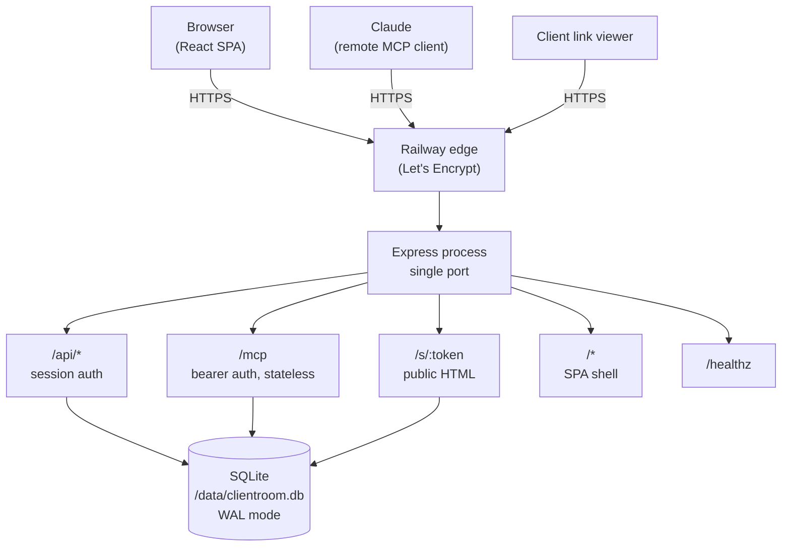

# 04. Technical architecture master

## What this system is

A single Node.js process serving a React front end, a JSON API, a public share page and an
MCP endpoint, all backed by one SQLite file on a mounted volume. One process, one port,
one deployable. No queue, no worker, no cache service.

## Stack

| Layer | Choice | Why |
|---|---|---|
| Runtime | Node.js 22 LTS | Matches the local toolchain, long support |
| HTTP | Express 5 | Stable, small surface, well understood |
| Database | SQLite via `better-sqlite3` | Synchronous, fast, prebuilt binaries, no service to run |
| Validation | Zod 4 | Shared schemas for API and MCP, one source of truth |
| MCP | `@modelcontextprotocol/sdk` 1.20+ | Official implementation of Streamable HTTP and JSON-RPC |
| Frontend | React 19 + Vite 6 | Small bundle, fast build, no framework runtime overhead |
| Styling | Handwritten CSS with custom properties | Precise control of the visual system |
| Tests | Vitest + Supertest + Playwright | Unit, integration, protocol and browser coverage |
| Container | Docker, `node:22-bookworm-slim` | Reproducible on Railway |
| Hosting | Railway, single service, volume at `/data` | Persistent storage on a managed platform |

No ORM. Plain prepared statements. No state library. No component library.

## Architecture diagram



## Request flow: a person editing

1. The browser sends `PATCH /api/items/:id` with the session cookie.
2. `requestContext` assigns a request id and starts a timer.
3. `attachUser` reads the cookie, verifies the HMAC signature and expiry, looks up the
   user.
4. `checkOrigin` compares the `Origin` header against the app origin.
5. `requireUser` rejects with 401 if there is no user.
6. `items` route validates the body with Zod, returns 422 on a bad value.
7. `updateItem` joins `items` to `projects` to confirm ownership, writes the row, touches
   the project's `updated_at`.
8. The route returns the updated item as JSON.
9. The browser updates the row in place and shows a toast.

## Request flow: Claude creating a project

1. Claude sends `POST /mcp` with `Authorization: Bearer crm_...` and
   `Accept: application/json, text/event-stream`.
2. `authenticateMcpRequest` hashes the token with SHA-256, looks up the user, re-reads
   the user row to catch a revoked credential.
3. The body is parsed as JSON. Empty or invalid body returns 400 with `-32700`.
4. `validateToolCall` checks the envelope: if it is a `tools/call`, the tool name must
   exist and the arguments must pass Zod. A failure returns a JSON-RPC `-32602`.
5. A per-request `McpServer` is created, bound to the authenticated user. The user id
   never comes from the request body.
6. The SDK transport handles the request. The tool handler calls `createProject`, which
   writes the row and returns the project.
7. The tool result is returned as JSON with `isError` false.
8. The server and transport are closed. Nothing is held in memory.

## Request flow: a client opening a link

1. The browser sends `GET /s/:token`.
2. `resolveShareToken` hashes the raw token, looks up the share link joined to its
   project.
3. If not found, 404. If revoked or expired, 410.
4. Otherwise the project title and items are rendered into the SPA shell server-side.
   The description is deliberately excluded.
5. The page is `noindex, nofollow`, with no analytics.

## Database

SQLite, `journal_mode=WAL`, `foreign_keys=ON`, `busy_timeout=5000`,
`synchronous=NORMAL`. One file at `/data/clientroom.db`, plus `-wal` and `-shm`.

Tables and columns are in `docs/05_DATABASE_AND_DATA_MODEL.md`. Four tables: `users`,
`projects`, `items`, `share_links`. Schema version is 1, applied at boot inside a
transaction using `PRAGMA user_version`. Idempotent.

Items inherit ownership through their project. The frozen table definition has no
`user_id` on items, so ownership is enforced by joining `projects.user_id` on every item
read and write. This is documented, not accidental.

## Authentication

### Web sessions

A signed cookie, `cr_session`, carrying `{ uid, exp }`, signed with HMAC-SHA256 over the
payload. Seven day expiry. `HttpOnly`, `SameSite=Lax`, `Secure` in production. No sessions
table. This keeps the frozen four-table model intact.

On every request, `attachUser` verifies the signature with a constant-time compare,
checks the expiry, and looks up the user. A missing or invalid cookie means no user, and
protected routes return 401.

### MCP credentials

Per user, generated as `crm_` plus 32 random bytes. Stored as SHA-256. The raw token is
shown once. A prefix of 12 characters is kept for display. Regenerating replaces the hash;
the old token returns 401 on the next request. Revoking clears the hash.

`authenticateMcpRequest` reads the `Authorization` header, extracts the bearer token,
hashes it, looks up the user, then re-reads the user row so a revoked credential cannot
resolve through a stale row.

### CSRF

`SameSite=Lax` blocks most cross-site form posts. In addition, every mutating request
with an `Origin` header must match the app origin or the request's own host. Non-browser
clients such as the MCP transport do not send `Origin`, so they pass through.

## MCP

### Transport

Streamable HTTP, stateless mode. `POST /mcp` with `Authorization: Bearer`. A server and
transport pair is created per request, so no session state is held in memory and no sticky
routing is required.

`GET /mcp` and `DELETE /mcp` return 405 with `Allow: POST`. The server does not
advertise an SSE stream it does not provide, which the specification permits.

Responses use `enableJsonResponse: true`, so a POST containing requests returns
`application/json`. This removes any dependency on long-lived connections through
Railway's edge.

### Error model

Three layers, deliberately separated.

| Layer | Condition | Response |
|---|---|---|
| HTTP | Missing or invalid bearer token | 401, `WWW-Authenticate: Bearer` |
| HTTP | Body is not valid JSON | 400 with JSON-RPC -32700 |
| JSON-RPC | Malformed request object | -32600 |
| JSON-RPC | Unknown method | -32601 |
| JSON-RPC | Schema violation | -32602 |
| Tool result | Record missing, not owned, conflict | `isError: true` with a readable message |
| Tool result | Unexpected failure | `isError: true` with a generic message, details in the server log |

Protocol misuse stays in the JSON-RPC error channel. Application errors become tool
results the model can read and act on. This is both more correct and more useful to Claude.

### Tools

Exactly five: `create_project`, `create_item`, `update_item`, `get_project`,
`list_projects`. Full schemas and examples are in `docs/06_MCP_COMPLETE_TECHNICAL_GUIDE.md`.

## Share links

Raw token: 24 random bytes, base64url, 32 characters. Stored as SHA-256. Creating a link
revokes any previous active link for that project, so a project has at most one live link.
Revocation is a row update, effective on the next request. The client page is checked on
every load: revoked returns 410, unknown returns 404.

The page is rendered server-side into the SPA shell with the project payload embedded, so
the client sees content without a second round trip and without a session. The project
description is deliberately excluded, so internal notes never reach a client.

## Security controls

| Control | Implementation |
|---|---|
| Password hashing | scrypt N=16384, r=8, p=1, 16-byte salt, 64-byte key |
| Session | HMAC-SHA256 signed payload, constant-time compare, 7 days |
| CSRF | SameSite=Lax plus Origin check on every mutating request |
| Headers | CSP, nosniff, frame-ancestors none, referrer policy |
| Rate limiting | In-memory per-IP limit on auth and credential endpoints |
| Input limits | JSON body capped at 64KB; field lengths enforced |
| Logging | Method, path, status, duration, request id. Never body, token or cookie |
| Secrets | Environment only; `.env` ignored; gitleaks pre-commit |
| MCP token | 32 random bytes, SHA-256 at rest, shown once, rotatable |
| Share token | 24 random bytes, SHA-256 at rest, revocable |
| Enumeration | Cross-user access returns 404, never 403 |

## Deployment

`railway.json` sets the Dockerfile build, start command and healthcheck. Volume mounted at
`/data`. Environment variables: `PORT` (injected), `DATABASE_PATH`, `SESSION_SECRET`,
`APP_ORIGIN`, `NODE_ENV`, and the optional `SEED_DEMO`, `SEED_EMAIL`, `SEED_PASSWORD`.

Healthcheck: `/healthz` returns 200 only when `SELECT 1` succeeds.

Backups: Railway daily schedule on the volume, 6-day retention, plus a manual backup before
the first production deploy. A file-level copy can be pulled with `tools/backup.sh` and a
restore was rehearsed against it.

## Known constraints and accepted trade-offs

1. Single instance. No replicas with a volume. Fine at this scale, stated openly.
2. Brief downtime on redeploy while the volume remounts.
3. SQLite is one writer at a time. WAL plus a 5s busy timeout is appropriate for a small
   studio tool, not for high write concurrency.
4. `POST /mcp` is stateless. No server-initiated notifications. Not needed for
   tool-calling connectors.
5. Vercel is used only for preview builds, never production, because its filesystem is
   ephemeral.
6. Rate limiting is per process and in memory.
7. `projects.status` is always `active`. The column exists and is returned by MCP, but
   nothing sets it to another value.
8. Session lifetime is seven days, fixed. No "remember me", no sliding expiry.
9. Share tokens are encrypted with a key derived from `SESSION_SECRET`. Rotating that
   secret invalidates live share links.
10. No password reset, no email verification, no dark mode, no internationalisation.

## Important directories and files

```
src/
  app.ts              Express app, routes, MCP endpoint, SPA fallback
  config.ts           Environment and validation
  index.ts            Boot, migrate, listen
  db/
    index.ts          SQLite open, migrate, ping
    schema.ts         Four tables, indexes, version 1
  lib/                errors, http, ids, logger, password, status, time, tokens, validation
  middleware/         auth, origin, rateLimit, errors
  routes/             auth, credential, projects, items
  services/           users, projects, items, share, credential
  mcp/                server, schemas, validate
  web/                sharePage (server-rendered client view)
  seed.ts             Demo account, labelled sample data
web/src/              React app: pages, components, styles
tests/                api.test.ts, mcp.test.ts, e2e/app.spec.ts
tools/                production-check.mjs, mcp-client-check.mjs, backup.sh, screenshots.mjs
docs/                 all documentation
```
