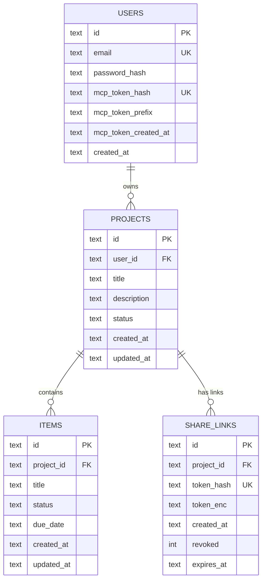

# 05. Database and data model

## Engine and runtime settings

SQLite via `better-sqlite3`, synchronous. Settings applied at open time:

- `journal_mode = WAL` (write-ahead logging, so readers do not block writers)
- `foreign_keys = ON`
- `busy_timeout = 5000`
- `synchronous = NORMAL`

One file at `/data/clientroom.db`, plus `-wal` and `-shm`. The file is the entire
database. Backing it up means copying all three files.

## Entity relationship diagram

## Table: users

| Column | Type | Constraints | Purpose |
|---|---|---|---|
| `id` | TEXT | PRIMARY KEY | UUID v4 |
| `email` | TEXT | NOT NULL, UNIQUE | Lowercased and trimmed |
| `password_hash` | TEXT | NOT NULL | `scrypt$N$r$p$salt$hash` |
| `mcp_token_hash` | TEXT | UNIQUE, NULL | SHA-256 of the raw MCP token |
| `mcp_token_prefix` | TEXT | NULL | First 12 characters, for display |
| `mcp_token_created_at` | TEXT | NULL | ISO 8601 |
| `created_at` | TEXT | NOT NULL | ISO 8601 |

## Table: projects

| Column | Type | Constraints | Purpose |
|---|---|---|---|
| `id` | TEXT | PRIMARY KEY | UUID v4 |
| `user_id` | TEXT | NOT NULL, FK users ON DELETE CASCADE | Owner |
| `title` | TEXT | NOT NULL | 1 to 200 chars |
| `description` | TEXT | NOT NULL DEFAULT '' | Internal only, never public |
| `status` | TEXT | NOT NULL DEFAULT 'active' | `active` only in this release |
| `created_at` | TEXT | NOT NULL | ISO 8601 |
| `updated_at` | TEXT | NOT NULL | ISO 8601, touched on item changes |

## Table: items

| Column | Type | Constraints | Purpose |
|---|---|---|---|
| `id` | TEXT | PRIMARY KEY | UUID v4 |
| `project_id` | TEXT | NOT NULL, FK projects ON DELETE CASCADE | Parent project |
| `title` | TEXT | NOT NULL | 1 to 200 chars |
| `status` | TEXT | NOT NULL DEFAULT 'not_started' | `not_started`, `in_progress`, `blocked`, `done` |
| `due_date` | TEXT | NULL | `YYYY-MM-DD` |
| `created_at` | TEXT | NOT NULL | ISO 8601 |
| `updated_at` | TEXT | NOT NULL | ISO 8601 |

Items have no `user_id` column. Ownership is enforced by joining `projects.user_id`
on every item read and write. This is the frozen schema's design, not an oversight.

## Table: share_links

| Column | Type | Constraints | Purpose |
|---|---|---|---|
| `id` | TEXT | PRIMARY KEY | UUID v4 |
| `project_id` | TEXT | NOT NULL, FK projects ON DELETE CASCADE | Parent project |
| `token_hash` | TEXT | NOT NULL, UNIQUE | SHA-256 of the raw token |
| `token_enc` | TEXT | NOT NULL | AES-256-GCM encrypted copy, for showing the URL to the owner |
| `created_at` | TEXT | NOT NULL | ISO 8601 |
| `revoked` | INTEGER | NOT NULL DEFAULT 0 | 0 or 1 |
| `expires_at` | TEXT | NULL | Deferred, always null in this release |

## Indexes

- `idx_projects_user_updated` on `projects(user_id, updated_at DESC)`
- `idx_items_project` on `items(project_id)`
- `idx_share_links_project` on `share_links(project_id)`
- `share_links.token_hash` is unique, so lookups by hash are indexed.

## Ownership model

- A project belongs to exactly one user. `projects.user_id` is a foreign key with
  cascade delete.
- A deliverable belongs to exactly one project. `items.project_id` is a foreign key
  with cascade delete.
- A share link belongs to exactly one project. `share_links.project_id` is a foreign
  key with cascade delete.
- There are no team members, no roles, no invitations. One owner per account.
- Deleting a user cascades to projects, which cascade to items and share links.

## Persistence

The database is a single file on a mounted volume at `/data/clientroom.db`. The
container writes to it directly. There is no separate database service.

On boot, `migrate()` reads `PRAGMA user_version`. If it is 0, it runs the schema SQL
inside a transaction and sets the version to 1. The schema uses `CREATE TABLE IF NOT
EXISTS`, so re-running is safe. Migrations are idempotent.

On redeploy, Railway stops the old container, starts the new one against the same volume,
and the app opens the same file. The persistence check signed in with an account created
before the redeploy, read the project, and found both deliverables with the edited status
intact. 5 of 5 checks passed.

## What happens on restart

1. The process starts, loads config, opens the database file.
2. `migrate()` checks the version and applies any pending migration.
3. The server listens on `PORT`.
4. The in-memory rate limit buckets are empty, so limits reset. This is documented as a
   limitation.

## What happens on redeploy

1. Railway builds the new image.
2. The old container stops. The volume stays mounted.
3. The new container starts, mounts the same volume, opens the same file.
4. Brief downtime while the volume remounts.
5. `/healthz` returns 200 once `SELECT 1` succeeds.

## Backup and restore

- Railway daily schedule on the volume, 6-day retention.
- A file-level copy can be pulled with `tools/backup.sh`, which downloads `clientroom.db`,
  `clientroom.db-wal` and `clientroom.db-shm` and runs `pragma integrity_check`.
- A restore was rehearsed: the deployed image booted against a copy of the database and
  served the data, including the demo account's project with all four deliverables and
  their statuses.
- Share tokens cannot be replayed from a backup, because only a hash is stored. The
  project content survives; old links do not have to.

## Session state is not a table

Session state is a signed cookie, not a table. This keeps the frozen four-table model
intact. The cookie carries the user id and an expiry, signed with `SESSION_SECRET`. No
server-side session storage is needed.

## Date and time

All timestamps are ISO 8601 strings in UTC, produced by `new Date().toISOString()`. Dates
are `YYYY-MM-DD`. No timezone conversion is performed; the client page renders dates in a
consistent format while the app uses the browser's native date input.
